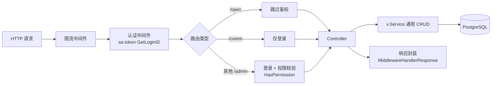

## 模块布局

Vgo 是多模块 Go 工作区，每个模块可独立构建与发版：

```text
vgo/
├── main.go                 # 应用入口（server / migrate 等命令）
├── internal/               # 应用装配：命令注册、驱动加载、打包占位
├── v/                      # 核心框架（独立模块 github.com/vera-byte/vgo/v）
│   ├── service.go          #   通用 CRUD 服务（ServiceList/ServicePage/...）
│   ├── controller.go       #   通用 REST 控制器与 EPS 元数据
│   ├── model.go            #   基础模型（ID/时间/软删除）
│   ├── vconfig/            #   多源配置（文件/consul/kubecm + 环境变量展开）
│   ├── vfile/              #   上传驱动抽象与扩展名白名单
│   └── vdb/                #   数据库驱动注册
├── modules/                # 业务模块（各自独立 go.mod）
│   ├── base/               #   用户/角色/菜单/部门/登录鉴权（sa-token）
│   ├── dict/               #   字典
│   ├── openapi/            #   开放平台（应用、RSA 签名、防重放）
│   ├── space/              #   空间
│   └── task/               #   定时任务
└── contrib/                # 插件（各自独立 go.mod）
    ├── drivers/{mysql,pgsql,sqlite}
    └── files/{local,minio,oss}
```

## 请求处理链路



**路由前缀语义**（`modules/base/middleware`）：

| 前缀 | 含义 | 示例 |
|------|------|------|
| `/admin/*/open/*` | 公开接口（登录/验证码） | `/admin/base/open/login` |
| `/admin/*/comm/*` | 仅需登录 | `/admin/base/comm/permmenu` |
| `/admin/*` | 登录 + 权限 | `/admin/base/sys/user/page` |
| `/openapi/*` | 签名验证（publicKey 白名单除外） | `/openapi/sign/verify` |

权限串由 URL 派生：`/admin/base/sys/user/page` → `base:sys:user:page`，与菜单 `perms` 字段匹配（支持 `*` 通配）。

## 核心抽象

| 抽象 | 位置 | 职责 |
|------|------|------|
| `v.Service` | `v/service.go` | 通用增删改查、分页、QueryOp 定制、修改钩子 |
| `v.Controller` | `v/controller.go` | REST 路由绑定、EPS 元数据、统一响应 |
| `v.Admin` | `v/ctx.go` | 请求上下文中的登录用户（UserId/RoleIds/IsAdmin） |
| `v.Model` | `v/model.go` | ID/CreateTime/UpdateTime/DeletedAt 基础字段 |
| `vfile.Driver` | `v/vfile` | 上传驱动（local/minio/oss） |

## 依赖管理约定

- 各模块 `go.mod` 通过 `replace` 指向工作区本地源码，克隆后**无需 go.work 即可构建**
- 发布按模块目录打 tag（`v/v1.x.x`、`modules/base/v1.x.x`），`replace` 不传递给下游
- `go.work` 可选（`bash gowork.sh` 生成），用于跨模块联调

详见 [开发与协作](/guides/development)。
