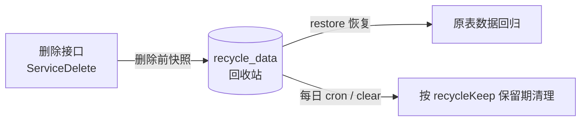

## 概述

数据回收模块（参照 [cool-admin-midway](https://github.com/cool-team-official/cool-admin-midway) 的 recycle 模块）在**数据删除时自动快照**被删内容到回收站表，提供查询、恢复与定期清理能力，防止误删导致数据永久丢失。



## 工作机制

| 环节 | 行为 |
|------|------|
| 删除 | 通用 CRUD 的删除（`v.Service.ServiceDelete`）在删除前自动记录快照；**快照失败则中止删除**（fail-safe，防止数据不可恢复） |
| 快照内容 | 被删行的完整 JSON、来源表（group/table）、操作人、请求接口与参数、条数 |
| 恢复 | 将快照原样插回原表（保留原主键），并消费回收记录 |
| 清理 | 每日 00:00 自动执行；按 `base_sys_conf` 中 `recycleKeep`（保留天数，种子里为 31 天）清理过期记录，未配置则全量清空 |

## 接口（/admin/recycle/data）

| 方法 | 路径 | 权限 | 说明 |
|------|------|------|------|
| POST | `/page` | `recycle:data:page` | 分页（含操作人 userName，支持 url/操作人关键字搜索） |
| GET | `/info` | `recycle:data:info` | 详情（含被删数据快照） |
| POST | `/restore` | `recycle:data:restore` | 恢复数据 `{"ids": [1,2,3]}` |
| POST | `/clear` | 登录即可 | 清理过期记录（等同每日定时任务） |

## 代码结构

```text
modules/recycle/
├── model/recycle_data.go          # recycle_data 表模型
├── service/recycle_data.go        # Record / Restore / Clear + 每日 cron
├── controller/admin/recycle_data.go
├── api/v1/recycle_data.go
└── resource/migrates/             # 建表迁移
```

**接入点**（对照参考实现的事件机制）：

| 参考实现（cool-admin） | 本实现 |
|----------------------|--------|
| `@Event(EVENT.SOFT_DELETE)` 事件回调 | `v.RegisterDeleteRecorder` 钩子（`v/hooks.go`），recycle 模块 init 时注册 |
| `BaseService` 删除时发事件 | `v.Service.ServiceDelete` 删除前调用钩子 |
| `CommonSchedule` 每日清理 | `gcron` 每日 00:00 定时任务 |
| `entityInfo: {dataSourceName, entity}` | `entityInfo: {"group":"default","table":"表名"}`（JSON 文本列） |
| `recycleKeep` 配置 | 同名配置存于 `base_sys_conf`（cKey/cValue） |

## 覆盖范围与限制

<Note>
快照钩子挂在**通用 CRUD 删除**（`v.Service.ServiceDelete`）上，即所有 `v.Controller` 体系的删除接口。
服务内部的定向清理（如角色权限关系重建时的 `role_menu` 删除）不经过该钩子，不产生回收记录。
</Note>

- 恢复会以**原主键插回**：若原行仍存在（例如未来引入软删除场景）会产生主键冲突并报错
- 快照按删除时刻的行数据原样恢复，**不做合并/差量**
- 删除请求的参数（params）仅作审计参考，恢复不依赖它

## 配置

`base_sys_conf` 表（管理端"参数配置"可维护）：

| key | 说明 | 默认 |
|-----|------|------|
| `recycleKeep` | 回收记录保留天数 | 31 |
