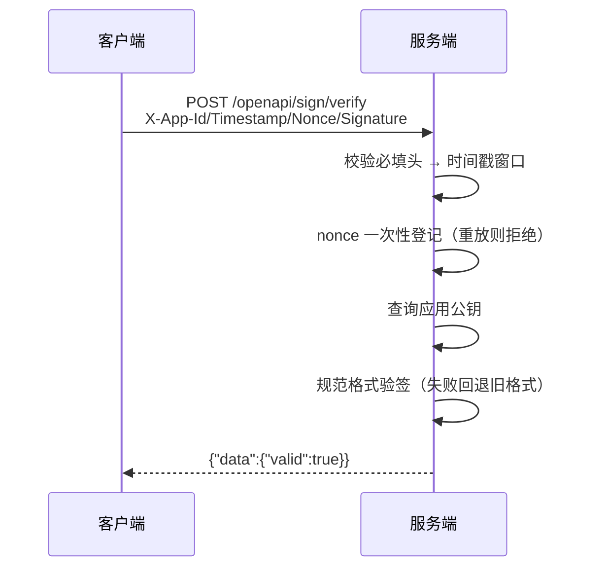

## 概述

开放平台为第三方应用提供**请求签名/验签**能力：

- 服务端为每个应用生成 **RSA 2048 密钥对**（私钥服务端托管，公钥可公开获取）
- 客户端使用**私钥**对请求签名（或由服务端 `generate` 代签）
- 服务端使用**公钥**验签，结合时间戳 + nonce 防重放

## 应用管理（管理员接口）

| 接口 | 说明 |
|------|------|
| `POST /admin/openapi/sign/createApp` | 创建应用，返回 `appId` / `appSecret` / 公私钥 |
| `GET /admin/openapi/sign/getAppInfo?appId=` | 查询应用信息（不含私钥） |
| `POST /admin/openapi/sign/testSign` | 服务端代签（联调用） |
| `POST /admin/openapi/sign/verifySign` | 服务端验签（联调用） |

## 请求签名规范

**待签串（规范格式，新客户端请使用）**：

```text
jsonBody + "\n" + appId + "\n" + timestamp + "\n" + nonce
```

四段以换行分隔，消除字段边界的拼接歧义。签名算法：**RSA PKCS#1 v1.5 + SHA-256**，结果 Base64 编码。

<Note>
旧版无分隔符拼接（`jsonBody+appId+timestamp+nonce`）验签仍然兼容，但**新接入请勿使用**；
后续版本将移除旧格式。
</Note>

**请求头**：

| 头 | 说明 |
|----|------|
| `X-App-Id` | 应用 ID |
| `X-Timestamp` | Unix 秒级时间戳（±5 分钟窗口） |
| `X-Nonce` | 随机串（窗口内一次性） |
| `X-Signature` | Base64 签名 |

**请求体**：`{"data": {...}}`，签名覆盖 `data` 的 JSON 序列化结果。

## 防重放

1. **时间戳窗口**：`|now - timestamp| ≤ 300s`
2. **nonce 一次性**：`appId + nonce + timestamp` 在 Redis 中以 `SETNX` 语义登记（10 分钟 TTL），
   重复请求返回 `4007 请勿重复请求`

## 验签流程



## 客户端签名示例（Go）

```go
signData := string(jsonBody) + "\n" + appId + "\n" +
    strconv.FormatInt(timestamp, 10) + "\n" + nonce
hash := sha256.Sum256([]byte(signData))
sig, _ := rsa.SignPKCS1v15(rand.Reader, privateKey, crypto.SHA256, hash[:])
signature := base64.StdEncoding.EncodeToString(sig)
```

## 免签白名单

默认全部 `/openapi/*` 均需签名，仅以下路径豁免：

| 路径 | 说明 |
|------|------|
| `GET /openapi/sign/publicKey` | 按 `appId` 查询公钥（公钥本应公开） |

白名单为**显式路径表、默认拒绝**（`modules/openapi/middleware/sign_verify.go`），新增开放接口必须在此登记。

## 代签与联调

`testSign`（管理员）接受 `appId/timestamp/nonce/data`，服务端用托管私钥生成签名返回；
随后可用 `verifySign` 或真实业务接口验证。同 `nonce` 的 `testSign` 记录会占用该 nonce（日志表查重）。
