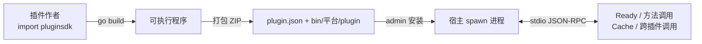

## 概述

vgo 插件是**独立的可执行程序**（如 Go 编译的二进制），通过 `pluginsdk` 与宿主通信（stdio 上的 JSON-RPC）。
插件包（ZIP）安装后由宿主拉起进程、调用方法、管理生命周期——契约对齐
[cool-admin-midway-plugin](https://github.com/cool-team-official/cool-admin-midway-plugin) 的 `BasePlugin`。



## 快速开始

### 0. 一键生成项目（推荐）

```bash
vgo-tools plugin my-plugin --key hello --name "Hello插件"
```

生成完整项目模板（`plugin.json` / `main.go` / `go.mod` / `README.md`），
直接进入第 2/3 步即可。

仓库内置完整可运行示例 [`example/`](https://github.com/vera-byte/vgo/tree/master/example)：
演示 `pluginInfo` / `cache` / `pluginService` 与配置 `@baseDir/` 路径解析，
打包安装后即可调用（见下文 invoke）。

| 选项 | 说明 | 默认 |
|------|------|------|
| `dst` | 目标目录 | 当前目录 |
| `--key / -k` | 插件唯一标识 | 目录名（小写、`-`/空格转 `_`） |
| `--name` | 插件名称 | 同 key |

<Note>
生成的 `go.mod` 依赖 `github.com/vera-byte/vgo/v` 的 pluginsdk 包；若尚未发版或本地调试，
在 go.mod 追加 `replace github.com/vera-byte/vgo/v => <vgo工作区>/v`。
</Note>

### 1. 编写插件

```go
package main

import (
    "fmt"

    "github.com/vera-byte/vgo/v/pluginsdk"
)

// HelloPlugin 插件结构体：嵌入 pluginsdk.Base 获得 pluginInfo/cache/pluginService
type HelloPlugin struct {
    pluginsdk.Base
}

// Ready 插件就绪回调（可选；单例插件仅启动时执行一次）
func (p *HelloPlugin) Ready() {
    fmt.Println("插件就绪")
}

// Show 业务方法：导出方法即插件 API（宿主按方法名调用，大小写不敏感）
func (p *HelloPlugin) Show(a, b int) (interface{}, error) {
    return map[string]interface{}{"info": p.PluginInfo, "sum": a + b}, nil
}

// UseCache 读写宿主缓存（跨插件/持久共享）
func (p *HelloPlugin) UseCache() (interface{}, error) {
    if err := p.Cache.Set("hello", "world"); err != nil {
        return nil, err
    }
    return p.Cache.Get("hello")
}

// CallOther 调用其他插件
func (p *HelloPlugin) CallOther() (interface{}, error) {
    return p.PluginService.Invoke("other-key", "Show", 1, 2)
}

func main() {
    pluginsdk.Run(&HelloPlugin{}) // 启动 stdio JSON-RPC 服务循环
}
```

方法签名约定：返回值支持 `(T, error)` / `(error)` / `(T)` / `()`；参数按 JSON 反序列化到形参。
`async` 等价语义：方法内自行并发即可（进程模型天然异步）。

### 2. 编写 plugin.json

```json
{
  "key": "hello-go",              // 唯一标识（不能为 plugin）
  "name": "Hello Go 插件",
  "version": "1.0.0",
  "author": "you",
  "description": "说明",
  "hook": "",                     // Hook 名（如 upload）；同 Hook 同时只能启用一个
  "singleton": true,              // true 常驻进程；false 每次调用拉起进程
  "readme": "README.md",
  "logo": "assets/logo.png",
  "config": {
    "greeting": "@baseDir/README.md",   // @baseDir/ 前缀自动解析为插件安装目录
    "domain": "https://api.example.com"
  }
}
```

### 3. 打包

使用 `vgo-tools plugin-pack`（交叉编译多平台并生成安装 ZIP）：

```bash
# 全平台（linux/darwin × amd64/arm64 + windows-amd64）
vgo-tools plugin-pack ~/plugins/hello-go

# 指定平台 / 输出名 / 主包路径
vgo-tools plugin-pack ~/plugins/hello-go \
    -p "linux-amd64 darwin-arm64" -o hello.zip -m ./cmd
```

参数说明：

| 选项 | 说明 | 默认 |
|------|------|------|
| `-p` | 平台列表（`goos-goarch` 空格分隔） | linux-amd64/arm64、darwin-amd64/arm64、windows-amd64 |
| `-o` | 输出 ZIP 路径 | `<key>-<version>.zip` |
| `-m` | 源码目录内 main 包相对路径 | `.`（目录根） |

打包会自动排除 `go build` 产物与源码文件，仅打包插件清单、静态资源与各平台二进制。

产物 ZIP 布局（`bin/<goos>-<goarch>/plugin` 按**宿主平台**匹配，`bin/plugin` 通用兜底）：

```text
plugin.zip
├── plugin.json
├── README.md
├── assets/logo.png
└── bin/
    ├── darwin-arm64/plugin      # macOS 本机
    ├── linux-amd64/plugin       # Linux 服务器
    ├── linux-arm64/plugin
    ├── darwin-amd64/plugin
    └── windows-amd64/plugin.exe
```

Windows 平台产物为 `plugin.exe`；构建参数为 `CGO_ENABLED=0 -trimpath -ldflags "-s -w"`（静态、精简）。
单平台包（如仅 `linux-amd64`）体积约 1.3MB，全平台约 6.3MB。

### 4. 安装与使用

管理端 `POST /admin/plugin/info/install`（multipart 上传 ZIP，`force` 跳过检查），
或直接 API：

```bash
curl -X POST http://host:8001/admin/plugin/info/install \
  -H "Authorization: <token>" -F "file=@my-plugin.zip"
```

安装即启用（status=1，进程拉起 + Ready 握手）。启停/卸载/热重载通过
`/admin/plugin/info/update|delete|reload` 即时生效。

调用插件方法（演示/联调用；生产调用建议服务端 `service.Invoke`）：

```bash
curl -X POST http://host:8001/admin/plugin/info/invoke \
  -H "Authorization: <token>" -H "Content-Type: application/json" \
  -d '{"key":"demo","method":"Greet","params":["vgo"]}'
```

## SDK API

| 能力 | 用法 |
|------|------|
| 插件信息 | `p.PluginInfo`（含 `Config`、`BaseDir`） |
| 宿主缓存 | `p.Cache.Get(key)` / `p.Cache.Set(key, value)`（落宿主 Redis/内存，跨插件共享） |
| 跨插件调用 | `p.PluginService.Invoke(key, method, params...)` |
| 就绪回调 | 实现 `Ready()` 方法 |
| 业务方法 | 任意导出方法即 API（大小写不敏感匹配） |

## Hook 插件

`plugin.json` 声明 `"hook": "upload"` 即成为上传 Hook 插件（同 Hook 同时只能启用一个）：

```go
// Upload 接管文件上传：返回值直接作为上传结果
func (p *HelloPlugin) Upload(ctx map[string]interface{}) (interface{}, error) {
    files := ctx["files"].([]interface{})
    f := files[0].(map[string]interface{})
    // f["data"] 为上传文件的临时路径，f["filename"] 为原始文件名
    return "https://cdn.example.com/" + f["filename"], nil
}
```

- 启用后 `/admin/base/comm/upload` 由插件接管；停用/卸载即回退默认上传实现
- `ctx`：`{files: [{data: 临时文件路径, filename}], fields: {...}}`
- 其他 Hook 名为预留扩展（宿主按 hook 名派发）

## 通信协议（宿主 ↔ 插件）

单行 JSON 消息、双向 stdio：

| 方向 | 方法 | 说明 |
|------|------|------|
| 宿主→插件 | `ready` | 启动就绪握手 |
| 宿主→插件 | `invoke` `{method, params}` | 调用插件导出方法 |
| 插件→宿主 | `cacheGet` / `cacheSet` | 宿主缓存读写 |
| 插件→宿主 | `pluginInvoke` `{key, method, params}` | 跨插件调用 |
| 插件→宿主 | `log` | 输出日志到宿主 |

环境变量：`VGO_PLUGIN_INFO`（插件信息 JSON）、`VGO_PLUGIN_BASE_DIR`（安装目录）。

## 生命周期与语义

| 概念 | 行为 |
|------|------|
| `singleton: true` | 常驻进程，启动时 `Ready` 一次，方法调用复用 |
| `singleton: false` | 每次方法调用拉起独立进程，调用完回收（实例状态不保留） |
| 启用/停用 | 拉起/终止进程，Hook 即时生效/回退 |
| 卸载 | 终止进程 + 删库记录 + 清理安装目录（不进回收站） |

## 安全提示

<Warning>
安装插件 = **在服务器上执行二进制**。仅安装可信来源插件；`plugin:info:*` 权限严格收口；
插件进程与宿主同权限运行，注意最小化插件的系统访问。
</Warning>
