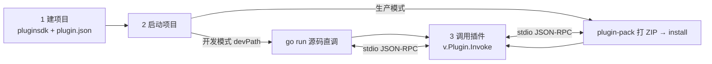

## 概述

vgo 插件是**独立的可执行程序**（如 Go 编译的二进制），通过 `pluginsdk` 与宿主通信（stdio 上的 JSON-RPC）。
插件由宿主拉起进程、调用方法、管理生命周期——契约对齐
[cool-admin-midway-plugin](https://github.com/cool-team-official/cool-admin-midway-plugin) 的 `BasePlugin`。

整个开发闭环分三步：**建项目**（写插件）→ **启动项目**（开发模式源码直调 / 打包安装）→ **调用插件**（服务端调用方法）。



---

## 一、建项目

### 1.1 生成脚手架

```bash
vgo-tools plugin my-plugin --key hello --name "Hello插件"
```

生成完整项目模板（`plugin.json` / `main.go` / `go.mod` / `README.md`）。选项：

| 选项 | 说明 | 默认 |
|------|------|------|
| `dst` | 目标目录 | 当前目录 |
| `--key / -k` | 插件唯一标识（调用时使用） | 目录名（小写、`-`/空格转 `_`） |
| `--name` | 插件名称 | 同 key |

也可以直接复制仓库内置的完整示例 [`example/`](https://github.com/vera-byte/vgo/tree/master/example)（演示 `pluginInfo` / `cache` / `pluginService`、`@baseDir/` 配置解析与 Hook 方法）：

```bash
cp -r example my-plugin && cd my-plugin
```

### 1.2 项目结构

```text
my-plugin/
├── main.go         # 插件入口：实现插件结构体 + pluginsdk.Run
├── plugin.json     # 插件清单（key/名称/版本/配置…）
├── go.mod          # 独立 Go 模块（依赖 pluginsdk）
├── README.md       # 插件说明（安装后在管理端展示）
└── assets/         # 静态资源（logo 等）
```

<Note>
`go.mod` 依赖 `github.com/vera-byte/vgo/v` 的 pluginsdk 包。本地调试或 SDK 未发版时，
务必加 replace 指向工作区源码，这样 SDK 改动也能被插件吃到：

```go
replace github.com/vera-byte/vgo/v => ../v   // 相对路径按你的目录布局调整
```
</Note>

### 1.3 编写插件代码（main.go）

```go
package main

import (
    "fmt"

    "github.com/vera-byte/vgo/v/pluginsdk"
)

// HelloPlugin 插件结构体：嵌入 pluginsdk.Base 获得 pluginInfo/cache/pluginService
type HelloPlugin struct {
    pluginsdk.Base
}

// Ready 插件就绪回调（可选；singleton 插件仅启动时执行一次）
func (p *HelloPlugin) Ready() {
    fmt.Println("插件就绪, key =", p.PluginInfo.Key)
}

// Show 业务方法：导出方法即插件 API（宿主按方法名调用，大小写不敏感）
func (p *HelloPlugin) Show(a, b int) (interface{}, error) {
    return map[string]any{"sum": a + b}, nil
}

// UseCache 读写宿主缓存（跨插件/持久共享，落宿主 Redis）
func (p *HelloPlugin) UseCache(key, value string) (interface{}, error) {
    if err := p.Cache.Set(key, value); err != nil {
        return nil, err
    }
    return p.Cache.Get(key)
}

// CallOther 跨插件调用（目标插件需已安装并启用）
func (p *HelloPlugin) CallOther(key, method string) (interface{}, error) {
    return p.PluginService.Invoke(key, method, 1, 2)
}

func main() {
    pluginsdk.Run(&HelloPlugin{}) // 启动 stdio JSON-RPC 服务循环
}
```

**方法即 API**：所有导出方法自动暴露给宿主，方法名匹配大小写不敏感。

**方法签名约定**：

| 形态 | 说明 |
|------|------|
| `(T, error)` | 返回值 + 错误（最常用） |
| `(error)` | 仅错误 |
| `(T)` | 仅返回值 |
| `()` | 无返回 |

参数按 JSON 反序列化到形参（宿主传 `params: [1, 2]` 对应 `(a, b int)`）；
方法内自行并发即可，进程模型天然异步。

**`pluginsdk.Base` 提供的能力**：

| 能力 | 用法 |
|------|------|
| 插件信息 | `p.PluginInfo`（含 `Config`、`BaseDir`、`Key`、`Name`…） |
| 读配置 | `p.PluginInfo.Config["greeting"]` / `p.PluginInfo.ConfigString("greeting")` |
| 宿主缓存 | `p.Cache.Get(key)` / `p.Cache.Set(key, value)` |
| 跨插件调用 | `p.PluginService.Invoke(key, method, params...)` |

### 1.4 编写 plugin.json

```json
{
  "key": "hello",                     // 唯一标识（调用时使用；不能为 plugin）
  "name": "Hello 插件",
  "version": "1.0.0",
  "author": "you",
  "description": "说明",
  "hook": "",                         // Hook 名（如 upload）；同 Hook 同时只能启用一个
  "singleton": true,                  // true 常驻进程；false 每次调用拉起进程
  "readme": "README.md",
  "logo": "assets/logo.png",
  "config": {
    "greeting": "hello from plugin",
    "greetingFile": "@baseDir/README.md",   // @baseDir/ 前缀解析为插件安装目录
    "domain": "https://api.example.com"
  }
}
```

字段要点：

- **`key`**：调用插件的唯一标识，与 `plugin_info.keyName` 对应
- **`singleton`**：`true` 启动时常驻（`Ready` 只执行一次，调用复用进程）；`false` 每次调用拉起独立进程、调完回收（实例状态不保留）。**开发模式建议 `true`**，否则每次调用都重新 `go run`
- **`config`**：随 `VGO_PLUGIN_INFO` 注入插件，`@baseDir/` 前缀在加载时解析为插件目录绝对路径
- **`hook`**：见后文 [Hook 插件](#hook-插件)

---

## 二、启动项目

两种方式按场景二选一：**日常开发用开发模式（源码直调）**，**交付部署用打包安装**。

### 2.1 开发模式：源码直调（推荐开发期使用）

不打包、不安装，`go run` 直接拉起源码进程。三步：

**① 建插件记录**（管理端插件页新增，或直接调 API），关键是填 **`devPath`** = 源码目录：

```bash
curl -X POST http://host:8001/admin/plugin/info/add \
  -H "Authorization: <token>" -H "Content-Type: application/json" \
  -d '{
        "name": "演示插件",
        "keyName": "demo",
        "description": "源码直调",
        "status": 1,
        "devPath": "example",
        "pluginJson": "{\"singleton\":true}",
        "config": "{}"
      }'
```

- `devPath`：相对**宿主进程工作目录**或绝对路径（如 `example`）
- `pluginJson`：至少含 `singleton`（建议 `true`），决定常驻/按次拉起
- `status: 1` 即启用；也可先 `0` 建好再启用

**② 启动/重载**：启用记录即拉起；改码后热重载：

```bash
curl -X POST http://host:8001/admin/plugin/info/reload \
  -H "Authorization: <token>" -H "Content-Type: application/json" \
  -d '{"key":"demo"}'
```

宿主会在源码目录内执行 `go run .`——**每次 Reload 重新编译**，改完源码调一次即生效。

**③ 验证启动**：就绪后 `Ready()` 会输出日志（如 `[demo-plugin] ready, key = demo`）；
再到调用一节试一手 `Show(1,2)`。

<Note>
开发模式要点：

- 仅 **`RunMode=dev`** 生效——生产环境设置了 `devPath` 只告警、不加载（安全门控）
- 宿主机需安装 **Go 工具链**（`go run` 是开发期依赖，生产不需要）
- 源码模块 `go.mod` 的 `replace .../v => ../v` 让插件吃到**本地 SDK** 改动
- 非单例插件每次调用都 `go run` 一次（Go 构建缓存下较快），开发期仍建议 `singleton: true`
</Note>

### 2.2 生产模式：打包安装

**① 打包**——`vgo-tools plugin-pack` 交叉编译多平台并生成安装 ZIP：

```bash
# 全平台（linux/darwin × amd64/arm64 + windows-amd64）
vgo-tools plugin-pack ~/plugins/my-plugin

# 指定平台 / 输出名 / 主包路径
vgo-tools plugin-pack ~/plugins/my-plugin \
    -p "linux-amd64 darwin-arm64" -o hello.zip -m ./cmd
```

| 选项 | 说明 | 默认 |
|------|------|------|
| `-p` | 平台列表（`goos-goarch` 空格分隔） | linux-amd64/arm64、darwin-amd64/arm64、windows-amd64 |
| `-o` | 输出 ZIP 路径 | `<key>-<version>.zip` |
| `-m` | 源码目录内 main 包相对路径 | `.`（目录根） |

产物 ZIP 布局（`bin/<goos>-<goarch>/plugin` 按**宿主平台**匹配，`bin/plugin` 通用兜底）：

```text
plugin.zip
├── plugin.json
├── README.md
├── assets/logo.png
└── bin/
    ├── darwin-arm64/plugin      # macOS 本机
    ├── linux-amd64/plugin       # Linux 服务器
    ├── linux-arm64/plugin
    ├── darwin-amd64/plugin
    └── windows-amd64/plugin.exe
```

Windows 平台产物为 `plugin.exe`；构建参数 `CGO_ENABLED=0 -trimpath -ldflags "-s -w"`（静态、精简）。
单平台包约 1.3MB，全平台约 6.3MB。打包自动排除源码，仅含清单、静态资源与各平台二进制。

**② 安装**——管理端上传 ZIP，或直接 API：

```bash
curl -X POST http://host:8001/admin/plugin/info/install \
  -H "Authorization: <token>" -F "file=@my-plugin.zip"
```

安装即启用（status=1，进程拉起 + Ready 握手）。ZIP 中同时保留 `plugin.json`/`readme`/`logo` 归档入库。

**③ 运维**——启停/卸载/热重载即时生效：

| 操作 | 接口 | 行为 |
|------|------|------|
| 启用/停用 | `POST /admin/plugin/info/update` | 拉起 / 终止进程，Hook 即时生效/回退 |
| 热重载 | `POST /admin/plugin/info/reload` `{"key":"…"}` | 停旧起新（改码/换包后用） |
| 卸载 | `POST /admin/plugin/info/delete` | 终止进程 + 删记录 + 清理安装目录 |

### 2.3 启动原理与生命周期

| 概念 | 行为 |
|------|------|
| 拉起 | 宿主 spawn 插件进程（安装版执行二进制；开发版 `go run .`），注入 `VGO_PLUGIN_INFO`（清单 JSON）、`VGO_PLUGIN_BASE_DIR`（安装/源码目录） |
| ready 握手 | 进程就绪后宿主发 `ready`，插件 `Ready()` 回调执行（singleton 仅一次） |
| `singleton: true` | 常驻进程，方法调用复用 |
| `singleton: false` | 每次调用拉起独立进程、调完回收（实例状态不保留） |

---

## 三、调用插件

### 3.1 服务端调用（主路径）

业务代码中经 `v.Plugin.Invoke`：

```go
raw, err := v.Plugin.Invoke(ctx, "demo", "Show", 1, 2)
// err == nil 时 raw 为插件方法返回值（JSON 反序列化后的 any）
```

签名：`v.Plugin.Invoke(ctx, key, method string, params ...interface{}) (interface{}, error)`

- `key`：插件标识（`plugin.json` 的 `key` / 记录的 `keyName`）
- `method`：导出方法名（大小写不敏感）
- `params`：按位置传参，经 JSON 传入插件形参

**返回值形态**随插件方法返回值而定。以 `example/` 为例：

| 调用 | 插件方法 | 返回 |
|------|---------|------|
| `Invoke(ctx, "demo", "Show", 1, 2)` | `Show(a, b int)` | `map[plugin:演示插件 key:demo sum:3]` |
| `Invoke(ctx, "demo", "Greet", "vgo")` | `Greet(name string)` | `"hello from plugin, vgo"` |
| `Invoke(ctx, "demo", "Hash", "abc")` | `Hash(text string)` | SHA256 摘要字符串 |
| `Invoke(ctx, "demo", "Info")` | `Info()` | `map[name:… version:… baseDir:… config:…]` |
| `Invoke(ctx, "demo", "UseCache", "k", "v")` | `UseCache(key, value)` | 宿主缓存读写结果 |

**错误语义**：

| 情况 | 返回 |
|------|------|
| 未引入 plugin 模块（实现未注册） | `插件调用未注册（未引入 plugin 模块）` |
| 插件不存在/已禁用 | `插件[key]不存在或已禁用` |
| 插件方法返回 error | 原样透传 |
| 插件进程崩溃 | 进程启动/RPC 相关错误（singleton 插件可 reload 恢复） |

### 3.2 跨插件调用

插件内调用其他插件（目标插件需已安装并启用）：

```go
func (p *HelloPlugin) CallOther(key, method string) (interface{}, error) {
    return p.PluginService.Invoke(key, method, 1, 2)
}
```

### 3.3 Hook 插件（接管内建行为）

`plugin.json` 声明 `"hook": "upload"` 即成为上传 Hook 插件（同 Hook 同时只能启用一个）：

```go
// Upload 接管文件上传：返回值直接作为上传结果
func (p *HelloPlugin) Upload(ctx map[string]interface{}) (interface{}, error) {
    files := ctx["files"].([]interface{})
    f := files[0].(map[string]interface{})
    // f["data"] 为上传文件的临时路径，f["filename"] 为原始文件名
    return "https://cdn.example.com/" + f["filename"], nil
}
```

- 启用后 `/admin/base/comm/upload` 由插件接管；停用/卸载即回退默认上传实现
- `ctx`：`{files: [{data: 临时文件路径, filename}], fields: {...}}`
- 其他 Hook 名为预留扩展（宿主按 hook 名派发）

---

## 通信协议（宿主 ↔ 插件）

单行 JSON 消息、双向 stdio：

| 方向 | 方法 | 说明 |
|------|------|------|
| 宿主→插件 | `ready` | 启动就绪握手 |
| 宿主→插件 | `invoke` `{method, params}` | 调用插件导出方法 |
| 插件→宿主 | `cacheGet` / `cacheSet` | 宿主缓存读写 |
| 插件→宿主 | `pluginInvoke` `{key, method, params}` | 跨插件调用 |
| 插件→宿主 | `log` | 输出日志到宿主 |

环境变量：`VGO_PLUGIN_INFO`（插件信息 JSON）、`VGO_PLUGIN_BASE_DIR`（安装/源码目录）。

## 安全提示

<Warning>
安装插件 = **在服务器上执行二进制**。仅安装可信来源插件；`plugin:info:*` 权限严格收口；
插件进程与宿主同权限运行，注意最小化插件的系统访问。`devPath` 仅开发模式生效，
生产环境不会执行 `go run` 源码。
</Warning>
