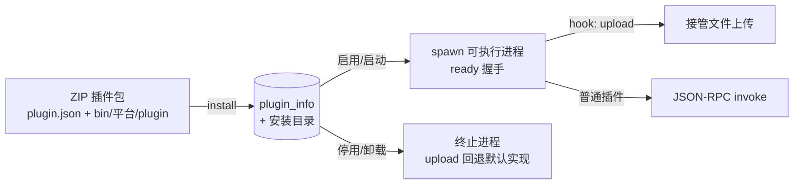

## 概述

插件模块（参照 [cool-admin-midway](https://github.com/cool-team-official/cool-admin-midway) 的 plugin 模块）支持上传 **ZIP 插件包**安装插件。插件本体是**独立可执行程序**（如 Go 编译的二进制，用 [`pluginsdk`](/guides/plugin-dev) 开发），宿主拉起进程并通过 **stdio JSON-RPC** 调用其方法；支持 **Hook 插件接管内建行为**（如 upload 上传）。

<Note>
插件**开发与打包**见 [插件开发指南](/guides/plugin-dev)（SDK 用法、plugin.json、平台二进制打包）。
本页说明宿主侧机制。
</Note>



## 原理与运转

插件**不共享宿主内存**：宿主把插件当子进程拉起，经 **stdin/stdout 上的单行 JSON 双向 RPC** 调遣。插件崩溃不拖垮主服务，语言不限于 Go——任何能说这套协议的可执行文件都可以。

两个角色分工：

| | 职责 | 代码 |
|----|------|------|
| **管理面** | ZIP 安装/启停/卸载、预检、Hook 互斥、热重载 | `modules/plugin`（对所有插件通用） |
| **执行层** | 进程拉起 + RPC + 方法派发 | 宿主侧 `modules/plugin/service/rpc.go`；插件侧 SDK `v/pluginsdk` |

通信协议（消息形如 `{id, method | result | error}`，双方各自递增 id、用 pending map 配对响应）：

```text
宿主 ──ready──▶  插件                           启动握手（10s 超时）；singleton 只握一次
宿主 ──invoke{method, params[]}──▶  插件        调用导出方法（30s 超时）
宿主 ◀──cacheGet / cacheSet / pluginInvoke / log──  插件    反向请求
```

- 正向 `ready` / `invoke`：`invoke` 的 `method` 即插件结构体的**导出方法名**（反射派发、大小写不敏感、参数 JSON 反解、返回值归一 `(T, error)` / `(error)` / `(T)` / `()`）
- 反向请求由宿主兑现：`cacheGet/cacheSet` 走宿主缓存（Redis/内存）、`pluginInvoke` 转发给其他插件进程（跨插件协作）、`log` 进宿主日志
- 进程启动时环境变量注入上下文：`VGO_PLUGIN_INFO`（插件信息 JSON）、`VGO_PLUGIN_BASE_DIR`（安装目录，`@baseDir/` 占位由 SDK 解析）

一次调用的完整时序：

```text
install(ZIP) → 落盘 data/plugins/<key>/plugin →（启用）spawn 进程
   → ready 握手 → invoke{method,params} → 插件反射执行导出方法 → result 返回
   →（可选反向 RPC：cache / pluginInvoke / log）
singleton=true  常驻复用；singleton=false 每次 invoke 独立进程、用完即毁
update/delete → ReloadKey 热重载（停旧起新；delete 不走回收站）
```

## 插件包规范

ZIP 结构：

```text
plugin.zip
├── plugin.json                 # 插件清单
├── README.md                   # 使用说明（plugin.json.readme 指定）
├── assets/logo.png             # Logo（plugin.json.logo 指定）
└── bin/<goos>-<goarch>/plugin  # 可执行程序（按宿主平台匹配；bin/plugin 通用兜底）
```

`plugin.json` 示例：

```json
{
  "key": "upload-marker",        // 唯一标识（不能为 plugin）
  "name": "上传标记插件",
  "version": "1.0.0",
  "author": "tester",
  "description": "说明",
  "hook": "upload",              // Hook 名；同名 Hook 同时只能启用一个
  "singleton": true,             // 单例：复用实例；false 每次调用新建
  "readme": "readme.md",
  "logo": "logo.png",
  "config": {"domain": "http://127.0.0.1:8002"}
}
```

插件代码契约（Go，用 `pluginsdk`）：

```go
type HelloPlugin struct{ pluginsdk.Base }

func (p *HelloPlugin) Ready() { ... }                       // 可选：就绪回调
func (p *HelloPlugin) Upload(ctx map[string]interface{}) (interface{}, error) {
    return "result/" + ..., nil                            // Hook 方法
}
func main() { pluginsdk.Run(&HelloPlugin{}) }
```

## 接口（/admin/plugin/info）

| 方法 | 路径 | 说明 |
|------|------|------|
| POST | `/install` | 安装插件（multipart `file` = ZIP，`force` 跳过检查） |
| POST | `/page` / GET `/info` / `/list` | 查询（含 readme/logo/pluginJson/config） |
| POST | `/add` `/update` `/delete` | 管理；**启用/停用/删除即时热生效** |
| POST | `/reload` | 按 key 热重载插件 |

安装检查语义（与参考一致）：`type 0` 信息不完整 / `1` 已存在将覆盖 / `2` 同名 Hook 插件已启用（互斥）/ `3` 通过。

## 机制对照

| 参考实现（cool-admin） | 本实现 |
|----------------------|--------|
| `eval(content)` 执行 `src/index.js` | **可执行程序 + stdio JSON-RPC**（`pluginsdk`） |
| `new Plugin()` + `init(...)` | 进程启动 + `ready` 握手 |
| `invoke(key, method, ...)` | `Invoke`/`InvokeHook` → RPC `invoke` |
| `BasePlugin.cache` | RPC `cacheGet/cacheSet`（宿主 Redis/内存） |
| `BasePlugin.pluginService` | RPC `pluginInvoke`（宿主路由到其他插件进程） |
| `@baseDir` 配置占位 | 同样支持（SDK 解析为插件安装目录） |
| `@Event` 事件总线 | 直接函数调用（单进程语义）；多进程部署需自行广播 |
| Hook 插件替换默认上传 | `v.RegisterUploadHook`：有启用的 `upload` 插件时接管上传，否则回退 vfile |
| 删除不走回收站 | 同样（`ServiceDelete` 覆写，清理安装目录） |

## 生命周期语义

| 操作 | 行为 |
|------|------|
| 安装 | 解析 ZIP → 写 `plugin_info`（同 key 覆盖、合并保留用户配置）→ 启用则即时加载 |
| 启用（status=1） | 拉起进程 + `ready` 握手；**Hook 插件启用时自动禁用同 Hook 的其他插件** |
| 停用（status=0） | 终止进程；Hook 插件停用后 `upload` 回退默认实现 |
| 删除 | 终止进程 + 删除记录 + 清理安装目录（不进回收站） |
| 启动 | 自动拉起全部启用插件（`InitAll`） |

## 运行时契约

- **`singleton: true`**：常驻进程；**`false`**：每次调用拉起独立进程（实例状态不保留）
- **upload Hook 的 ctx**：`{files: [{data: 临时文件路径, filename}], fields: {...}}`
- **配置解析**：`config` 支持 `@env` 多环境节点与 `@baseDir/` 路径占位
- **调用超时**：单次方法调用 30s（`ready` 握手 10s）

## 安全提示

<Warning>
安装插件 = **执行上传的可执行程序**（独立进程，经 RPC 暴露其导出方法）。仅限管理员安装可信来源插件；
`/admin/plugin/info/*` 的权限点（`plugin:info:install` 等）应严格收口。
</Warning>

## 代码结构

```text
v/pluginsdk/                        # 插件开发 SDK（随 v 模块发布，import github.com/vera-byte/vgo/v/pluginsdk）
├── plugin.go                       # Base / PluginInfo / Cache / PluginService
└── server.go                       # stdio JSON-RPC 运行时 + 方法派发

modules/plugin/                     # 宿主
├── model/plugin_info.go            # plugin_info 表模型
├── service/
│   ├── plugin.go                   # 安装（解包可执行文件）/启停/卸载/热重载
│   ├── center.go                   # 插件中心（进程注册表 + Hook 派发）
│   ├── rpc.go                      # 进程管理 + JSON-RPC 客户端（含反向调用）
│   └── upload_hook.go              # upload Hook 桥接
├── controller/admin/plugin_info.go
└── resource/migrates/              # 建表迁移
```

与参考实现的差异：插件由 JS 脚本改为**可执行程序**（Go 原生运行）；TS d.ts 工具不适用已移除；多进程事件总线简化为宿主内直调。
