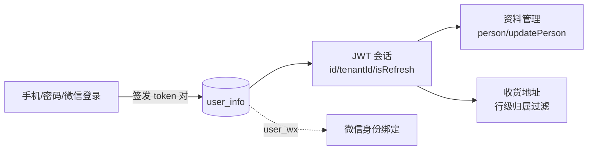

## 概述

用户模块（参照 [cool-admin-midway](https://github.com/cool-team-official/cool-admin-midway) 的 user 模块）面向 **APP/小程序/公众号** 的 C 端用户：多方式登录、资料管理、收货地址。与管理端（admin）鉴权体系**相互隔离**（独立会话、独立配置）。



## 登录方式（/app/user/login，全部免登录）

| 方法 | 路径 | 说明 |
|------|------|------|
| POST | `/phone` | 手机验证码登录（不存在自动注册，昵称脱敏） |
| POST | `/password` | 密码登录（**bcrypt**，兼容旧 MD5 并自动升级） |
| POST | `/smsCode` | 发送短信验证码（先校验图片验证码） |
| GET | `/captcha` | 图片验证码（复用基础模块能力） |
| POST | `/refreshToken` | 刷新会话（refreshToken 轮换语义） |
| POST | `/mini` | 小程序登录（code2session + 加密数据解密） |
| POST | `/mp` | 公众号登录（网页授权） |
| POST | `/wxApp` | 微信 APP 授权登录 |
| POST | `/miniPhone` | 小程序手机号登录 |
| POST | `/uniPhone` | 一键手机号登录（经 `uniphone` 插件） |

登录返回与管理端同构的 token 对：

```json
{ "expire": 86400, "token": "…", "refreshExpire": 2592000, "refreshToken": "…" }
```

<Note>
C端会话基于 **sa-token（gf 集成 `integrations/gf`）**：Random64 服务端会话，独立 `satoken:user:`
KeyPrefix，**与管理端会话完全隔离**（顶号/踢人/刷新互不影响）；refreshToken 不能用作访问令牌。
密码存储为 bcrypt，历史 MD5 首次登录自动升级；改密后强制下线该用户全部会话。
</Note>

## 用户信息（/app/user/info，需登录）

| 方法 | 路径 | 说明 |
|------|------|------|
| GET | `/person` | 个人信息（不含密码） |
| POST | `/updatePerson` | 更新资料（白名单：昵称/头像/性别/介绍；头像经 `upload` 插件转存） |
| POST | `/updatePassword` | 修改密码（短信验证码校验） |
| POST | `/bindPhone` | 绑定手机号（短信验证码） |
| POST | `/miniPhone` | 绑定小程序手机号 |
| POST | `/logoff` | 注销（资料脱敏 + 状态置已注销） |

## 收货地址（/app/user/address，需登录）

标准 CRUD（`add/delete/update/info/list/page`）+ `GET /default` 默认地址；
**行级归属过滤**：所有操作仅限本人地址（Info/Update/Delete 均校验 `userId`，防越权）；
设为默认地址时自动取消该用户其他默认（`ModifyAfter` 联动）。

## 管理端（/admin/user）

| 前缀 | 说明 |
|------|------|
| `/admin/user/info` | 用户管理（标准 CRUD，权限点 `user:info:*`） |
| `/admin/user/address` | 收货地址管理（标准 CRUD） |

## 短信验证码

发送经**插件分发**：优先调用已安装的 `sms-tx` / `sms-ali` 插件（`plugin.send(phones, code)`）；
未安装插件时——`modules.user.sms.debug: true` 则验证码写日志便于联调，否则报错提示安装。
验证码缓存 `sms:<手机号>`，有效期 `sms.timeout` 秒（默认 180），校验通过即失效。

## 微信集成（service/wx.go）

| 能力 | 说明 |
|------|------|
| `Code2Session` | 小程序登录凭证换会话（openid/sessionKey/unionid） |
| `OAuth2UserInfo` | 公众号/APP 网页授权换用户信息 |
| `DecryptData` | AES-256-CBC 解密微信加密数据（手机号/用户信息） |
| `WxMpConfig` | 公众号 JS-SDK 配置（access_token → jsapi_ticket → 签名） |

凭据取 `modules.user.wx.appId/appSecret`。

## 配置（config.yaml）

```yaml
modules:
  user:
    token:
      expire: 86400           # 会话有效期（秒）
      refreshExpire: 2592000  # refreshToken 有效期提示（秒）
    sms:
      timeout: 180            # 验证码有效期（秒）
      debug: false            # 无短信插件时是否写日志
    wx:
      appId: "wx..."
      appSecret: "${VGO_WX_APP_SECRET}"
```

旧键名 `modules.user.jwt.*` 仍兼容（`token.*` 优先）。会话无需签发密钥（Random64 随机令牌）。
登录返回结构保持 `{expire, token, refreshExpire, refreshToken}`，前端无需改动。

## 代码结构

```text
modules/user/
├── model/            # user_info / user_address / user_wx
├── service/
│   ├── satoken.go    # sa-token 会话（integrations/gf）
│   ├── login.go      # 全登录流 + 会话签发
│   ├── info.go       # 资料/密码/绑定/注销
│   ├── address.go    # 地址（归属过滤 + 默认地址互斥）
│   ├── sms.go        # 短信（插件分发）
│   └── wx.go         # 微信开放平台
├── middleware/app.go # C端鉴权（默认拒绝 + 登录接口白名单）
├── controller/       # app/login·info·comm·address + admin/info·address
└── resource/migrates # 建表迁移
```

## 鉴权与隔离

- 中间件作用于 `/app/user/*`：默认拒绝，登录类接口显式放行（白名单），refreshToken 拒作访问令牌
- 会话能力（sa-token）：顶号挤下线、刷新轮换、改密强制下线、租户信息存会话
- 与管理端会话**完全隔离**（独立 KeyPrefix `satoken:user:`、独立配置、独立登录入口）
- 地址等用户数据带**行级归属过滤**（List/Page 查询条件 + Info/Update/Delete 归属校验）
